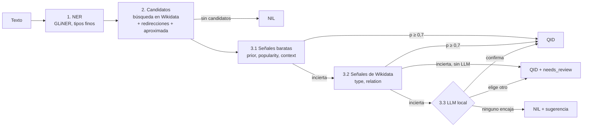

# Entity Linker

Servicio REST de Reconocimiento de Entidades Nombradas (NER) y Enlace de Entidades (*Entity Linking*) a **Wikidata**, desarrollado como prueba técnica para la posición de Desarrollador de IA.

Dado un texto, detecta las entidades nombradas y enlaza cada una con su QID de Wikidata (o `NIL`), resolviendo los casos en que varias entidades comparten nombre. Idioma principal: inglés; español con `language=es`.

---

## Arquitectura del Pipeline



Cada candidato recibe cinco señales (`prior`, `popularity`, `context`, `type`, `relation`) que un logit condicional con pesos aprendidos convierte en una probabilidad. Lo caro solo se ejecuta cuando lo barato no basta: las consultas SPARQL, para las menciones inciertas, y el LLM, para las que siguen inciertas. Cada entidad sale con su explicación (`reasoning`) y, si es dudosa, marcada para revisión humana con los candidatos alternativos. El diseño, la justificación experimental y las alternativas descartadas están en [`docs/memoria_resumen.md`](docs/memoria_resumen.md).

**Qué es `confidence`.** Es la probabilidad softmax del candidato elegido: una puntuación de *ranking*, **relativa a los candidatos recuperados**, no la probabilidad de que el enlace sea correcto. Con un único candidato vale 1 por construcción, y si el correcto no se recuperó, el mejor de los incorrectos puede salir con valor alto. Queda como mejora propuesta un candidato NIL virtual dentro del softmax, que daría NIL y una confianza absoluta en el mismo modelo (sección 6.2 de la memoria).

---

## Requisitos e Instalación

Requiere Python 3.11 (fijado en `.python-version`) y [**`uv`**](https://docs.astral.sh/uv/) como gestor de entorno y paquetes.

```bash
git clone https://github.com/mccv287-sudo/prueba-tecnica.git
cd prueba-tecnica
uv sync
```

- **GLiNER:** el modelo (~1 GB) se descarga de Hugging Face la primera vez que arranca el servicio. PyTorch se instala en su versión solo CPU.
- **LLM local (opcional):** solo se necesita con `use_llm: true`.
  1. Instala [Ollama](https://ollama.com). En Linux (queda como servicio de systemd, que arranca solo):

     ```bash
     curl -fsSL https://ollama.com/install.sh | sh
     ```

     En macOS y Windows, descarga la aplicación de ollama.com; con ella abierta, el servidor está activo.
  2. Descarga el modelo (~1,9 GB):

     ```bash
     ollama pull qwen2.5:3b
     ```

  3. Comprueba que el servidor responde en `http://localhost:11434` (si no está como servicio, arráncalo con `ollama serve`):

     ```bash
     ollama run qwen2.5:3b "hola"   # responde -> funciona
     ollama ps                      # columna PROCESSOR: GPU o CPU
     ```

  Si el servidor no está activo, el servicio no falla: cada llamada al LLM falla y la mención se queda con el mejor candidato según las señales.

### Configuración

Los valores ajustables (modelos, URLs, umbrales, pesos) están en [`src/entity_linker/config.py`](src/entity_linker/config.py). Los de despliegue se pueden sobrescribir con variables de entorno `ENTITY_LINKER_<NOMBRE>`:

| Variable | Por defecto |
|---|---|
| `ENTITY_LINKER_GLINER_MODEL` | `urchade/gliner_multi-v2.1` |
| `ENTITY_LINKER_LLM_MODEL` | `qwen2.5:3b` |
| `ENTITY_LINKER_OLLAMA_URL` | `http://localhost:11434/v1/chat/completions` |
| `ENTITY_LINKER_CACHE_PATH` | `.cache/wikidata.sqlite` (en la raíz del proyecto) |
| `ENTITY_LINKER_USER_AGENT` | `EntityLinker/1.0 (...)` |

---

## Ejecución del Servicio API

```bash
uv run uvicorn entity_linker.api:app --reload
```

El servidor estará disponible en `http://127.0.0.1:8000`, con la documentación interactiva (Swagger UI) en **`http://127.0.0.1:8000/docs`**. En `POST /api/v1/link/text` → *Try it out*, el desplegable *Examples* incluye biografías de estilo enciclopédico en inglés y español, además de casos de contexto, homónimos y NIL (los ejemplos en español necesitan `language=es`).

### Petición (`POST /api/v1/link/text`)

El cuerpo es el texto tal cual (`text/plain`, UTF-8); las opciones van como parámetros de la URL:

| Parámetro | Por defecto | Descripción |
|---|---|---|
| `language` | `en` | Idioma del texto (para buscar en Wikidata) |
| `use_llm` | `true` | El LLM local resuelve las menciones inciertas |
| `review_threshold` | `0.7` | Por debajo, la entidad se marca con `needs_review` |
| `max_candidates` | `2` | Candidatos devueltos por entidad (máximo 20) |


### Respuesta (real, recortada a una entidad)

```json
{
  "original_text": "Marie Curie was born in Warsaw and studied at the University of Paris.",
  "entities": [
    {
      "text": "University of Paris",
      "start_char": 50,
      "end_char": 69,
      "label": "ORG",
      "fine_label": "university",
      "qid": "Q209842",
      "wikidata_label": "University of Paris",
      "wikidata_description": "French university (c. 1150–1970)",
      "confidence": 0.977,
      "is_nil": false,
      "reasoning": "p=0.98 sobre 20 candidatos; frente a Q999763 (University of Paris 1 Pantheon-Sorbonne): relation +4.3, prior +1.0",
      "llm_confirmed": null,
      "needs_review": false,
      "candidates": [
        {
          "qid": "Q209842",
          "label": "University of Paris",
          "description": "French university (c. 1150–1970)",
          "concept_uri": "http://www.wikidata.org/entity/Q209842"
        },
        {
          "qid": "Q999763",
          "label": "University of Paris 1 Pantheon-Sorbonne",
          "description": "French university located at the heart of the Latin Quarter, in Paris",
          "concept_uri": "http://www.wikidata.org/entity/Q999763"
        }
      ]
    }
  ],
  "processing_time_ms": 447.5
}
```

Las otras dos entidades se enlazan con `Q7186` (Marie Curie, confianza 0,86) y `Q270` (Warsaw, 0,99), ambas sin revisión. En "University of Paris" compiten la universidad histórica y sus sucesoras; `relation` decide (la universidad histórica está unida a Marie Curie en Wikidata) y `reasoning` lo explica. `llm_confirmed` es `null` porque no se consultó al LLM. El tiempo es con la caché de Wikidata caliente.

---

### Limitaciones conocidas

- **La recuperación es el cuello de botella:** en el 19 % de las menciones de AIDA el QID correcto no está entre los 20 candidatos (p. ej., "Japan" por la selección de fútbol).
- **`confidence` no está calibrada** (ver arriba): `needs_review` detecta la duda entre candidatos, pero no los errores en que toda la lista es mala.
- **NIL:** sin LLM solo se predice cuando no hay candidatos (recall bajo).
- **LLM local lento:** ~15 s por llamada en una GPU de 4 GB; un texto largo con muchas menciones inciertas puede tardar minutos.

Detalle y mejoras propuestas en las secciones 4 y 6 de la memoria.

---

## Estructura del Proyecto

```text
entity-linker/
├── pyproject.toml / uv.lock / .python-version
├── notebooks/walkthrough.ipynb    # Recorrido por las fases del pipeline con datos reales
├── docs/memoria_resumen.md        # Resumen para la memoria y opciones consideradas
├── scripts/
│   ├── build_disambiguation_sample.py  # Muestras de desambiguación (AIDA + candidatos)
│   ├── tune_weights.py                 # Aprende los pesos del logit
│   └── compare_llm.py                  # LLM local frente a Claude (API)
├── src/entity_linker/
│   ├── api.py                     # FastAPI: lifespan, endpoint de texto libre y ejemplos
│   ├── config.py                  # Valores ajustables (ENTITY_LINKER_*) y rutas
│   ├── schemas.py                 # Modelos Pydantic v2 (petición/respuesta)
│   ├── pipeline.py                # Orquestador: 1. NER → 2. candidatos → 3. desambiguación
│   ├── ner.py                     # 1. GLiNER con tipos finos (→ PER/ORG/LOC/MISC)
│   ├── wikidata/                  # 2. Candidatos de Wikidata
│   ├── disambiguation/            # 3. Modulo de desambiguación
│   └── evaluation/                # Métricas y evaluación para cada proceso
└── tests/                         # Pruebas con pytest (red simulada)
```
